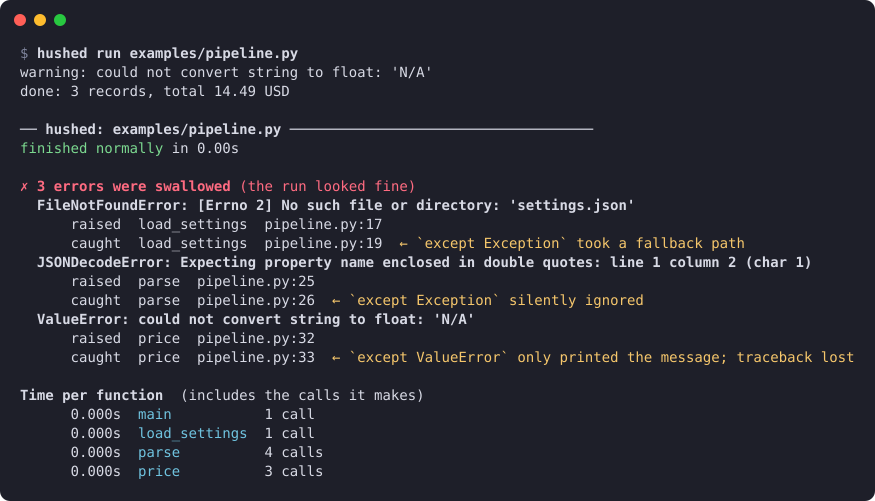
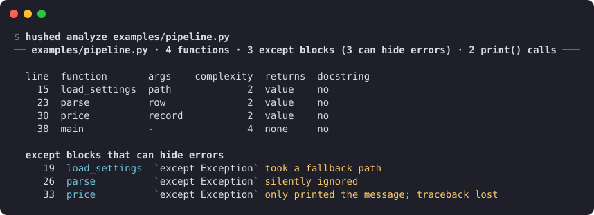

# Getting started

## Install

```bash
pip install hushed
```

hushed needs Python 3.12 or newer and works on Linux, macOS and Windows. It has no dependencies,
so it can't conflict with the packages your script uses. Install it in the same environment as
the script you want to watch, so the script finds its own packages.

To build it from a checkout instead, see [Development](development.md).

## Your first run

Put `hushed run` in front of the command you would normally use. Everything after the script name
is passed to the script:

```bash
hushed run job.py --input data.csv      # instead of: python job.py --input data.csv
hushed run -m mypackage.tool            # instead of: python -m mypackage.tool
```

The repository has a small example, `examples/pipeline.py`. It is a data job that prints "done"
even though part of its work failed:



The first two lines are the script's own output; hushed doesn't change it. After the script ends,
hushed writes its report to stderr:

1. **The status line.** The script finished normally, so a plain `python` run would have looked
   fine.
2. **The swallowed errors.** Each entry shows the exception, the line where it was **raised**, the
   line that **caught** it, and what that `except` block did with it. Here:
   - `load_settings` couldn't find `settings.json`. A broad `except Exception` quietly returned
     defaults, so the job ran with settings nobody chose.
   - `parse` met a broken row. `except Exception` returned `None`, and the row vanished.
   - `price` hit `'N/A'`. Its `except Exception` printed a one-line warning, so you know
     something went wrong but not which row, and the traceback is gone.
3. **Time per function.** Each function's time includes the calls it makes.

Only broad handlers (`except:`, `except Exception`, `except BaseException`) can swallow an error.
Errors caught on purpose (by a handler for a specific exception type, logged with a traceback, or
suppressed with `contextlib.suppress`) are counted on a separate line. Add `--all` to list them too.

## Or import it

If the program is started some other way (a launcher, an IDE, a scheduler), add one line at the
top of its entry point instead:

```python
import hushed
```

Then run the program as usual. The same report is printed when it exits. Options are environment
variables, and `HUSHED=0` turns it off without removing the line; see
[Commands](commands.md#import-hushed). [`examples/app/`](../examples/app/main.py) is a small app
with several modules and a thread pool, watched by that one line.

## Look before you run

`hushed analyze` reads files without running them. It lists every function with its complexity,
and every `except` block that *can* hide an error:

```bash
hushed analyze src/
```



`analyze` shows what could go wrong; `run` shows what did go wrong in one particular run.

## Next steps

- [Commands](commands.md): all options, exit codes, and which code is watched
- [The report](report.md): exactly how each `except` block is judged, and the JSON format
- [Using hushed in CI](ci.md): fail a nightly job when it swallows errors
